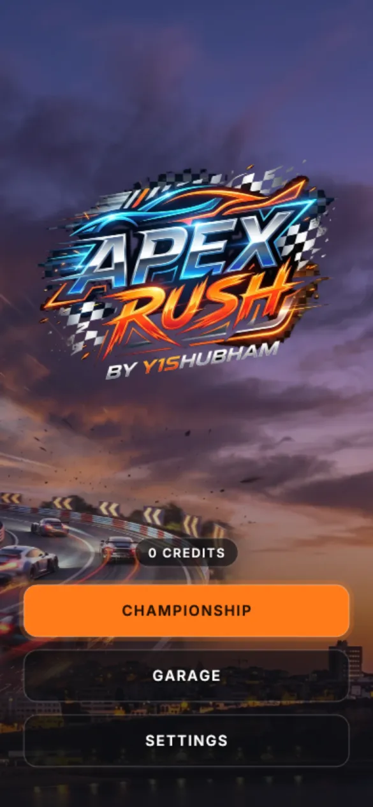
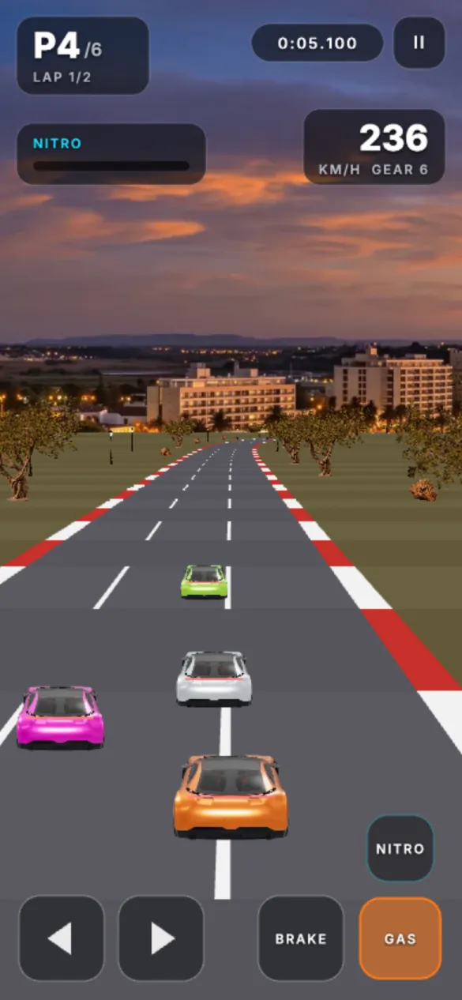
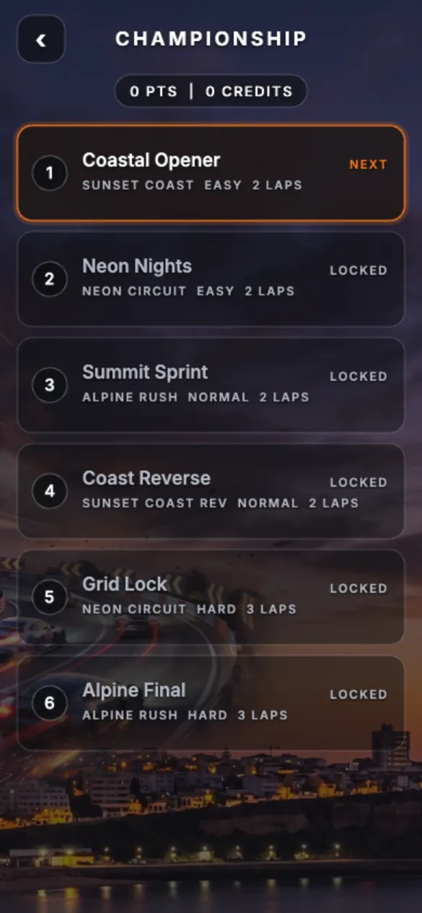
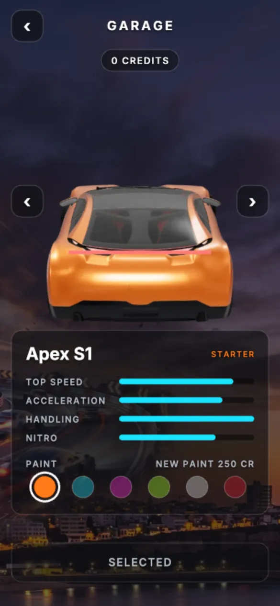

# APEX RUSH

A pseudo-3D arcade racing game for the browser, built with Phaser 4 and TypeScript. Race AI opponents across three tracks, chain drifts to charge nitro, earn credits and championship points, and unlock faster cars. Mobile-first with full touch controls, and fully playable on desktop with a keyboard.

<p align="center">
  
  
  
  
</p>

## Features

- Pseudo-3D road renderer with curves, hills, rumble strips, scenery and a parallax photo backdrop per track
- Arcade handling with speed-sensitive steering, off-road slowdown, and momentum-based car and roadside collisions
- Automatic drift: hold gas and full steer at high speed to slide through corners
- Drift-to-boost: controlled drifts bank score and nitro, crashes and running wide lose the reward
- Five AI opponents with their own driving styles, racing lines, overtaking and mistakes, on easy, normal and hard
- Six-event championship with points, credits, best laps and unlockable cars and paints
- Three cars with distinct stats, six paints each
- Progress saved locally with a validated, versioned save format
- Multi-touch controls on phones, keyboard on desktop, auto-pause when the game loses focus
- Synthesized engine, effects and music, with separate volume settings

## Controls

| Action          | Keyboard                         | Touch                            |
| --------------- | -------------------------------- | -------------------------------- |
| Accelerate      | W / Up                           | Gas                              |
| Brake / reverse | S / Down                         | Brake                            |
| Steer           | A D / Left Right                 | Left and right pads              |
| Drift           | Gas + full steer above 85% speed | Gas + full steer above 85% speed |
| Nitro           | Shift (hold)                     | Nitro (hold)                     |
| Pause           | Esc / P                          | Pause button                     |

Drifts start after a quarter second of gas and full steer at speed, and continue while you keep gas and steer into the slide. Drifting into a bend earns the most score and nitro.

## Tracks and cars

| Track        | Setting              | Character                         |
| ------------ | -------------------- | --------------------------------- |
| Sunset Coast | Coastal city at dusk | Long straights, beginner friendly |
| Neon Circuit | Downtown at night    | Tight, frequent bends             |
| Alpine Rush  | Mountain village     | Steep hills and technical corners |

| Car       | Class       | Unlock                            |
| --------- | ----------- | --------------------------------- |
| Apex S1   | Starter     | Owned                             |
| Vortex GT | Performance | 1500 credits or win Summit Sprint |
| Phantom R | Elite       | 4000 credits or win Grid Lock     |

## Championship

Six events unlock one after another, ending with hard AI in the fastest cars. Finishing positions award 10, 7, 5, 3, 2 and 1 points, and each event keeps your best result. Credits come from position plus drift score, and are paid once per race.

## Tech stack

- Phaser 4 (WebGL)
- TypeScript in strict mode
- Vite
- Vitest for unit tests
- ESLint and Prettier
- Web Audio API for all sound

No backend: everything runs in the browser and progress lives in `localStorage`.

## Getting started

Requires Node 20 or newer.

```sh
npm install
npm run dev
```

Then open the URL Vite prints. On a phone, use your machine's local network address.

| Script            | Purpose                            |
| ----------------- | ---------------------------------- |
| `npm run dev`     | Start the dev server               |
| `npm run build`   | Type-check and build to `dist/`    |
| `npm run preview` | Serve the production build locally |
| `npm test`        | Run unit tests                     |
| `npm run lint`    | Lint the codebase                  |
| `npm run format`  | Format with Prettier               |

## Project structure

```text
src/
  config/     Tuning data: cars, tracks, physics, AI, championship
  core/       Pure game logic: physics, track builder, AI, race, save, garage, championship
  render/     Road renderer, sprite loading, particle effects
  scenes/     Phaser scenes, HUD, input and touch controls, shared UI
  audio/      Synthesized sound and music
  assets/     Cars, scenery, backdrops, logo and menu art
tests/        Unit tests for core logic
```

Gameplay rules live in `src/core` with no Phaser dependency, so physics, AI, race flow, scoring and save validation are all unit tested.

## Deployment

The build is static. Any static host works, for example Vercel:

- Framework preset: Vite
- Build command: `npm run build`
- Output directory: `dist`

## Credits

- Car model: [CarConcept](https://github.com/KhronosGroup/glTF-Sample-Assets/tree/main/Models/CarConcept) by Darmstadt Graphics Group GmbH, based on a CC0 model by Unity Fan, licensed [CC BY 4.0](https://creativecommons.org/licenses/by/4.0/). Rendered to sprites with recoloured paint, an added light bar, and the logo and licence plate removed.
- Roadside props: [Poly Haven](https://polyhaven.com) models island_tree_02, street_lamp_01, street_lamp_02, boulder_01, namaqualand_boulder_02, concrete_road_barrier, modular_electricity_poles and fir_sapling_medium (CC0), rendered to sprites.
- Backdrops, logo and menu art: created by the author.
- Font: [Inter](https://fonts.google.com/specimen/Inter) via Google Fonts (SIL Open Font License).
